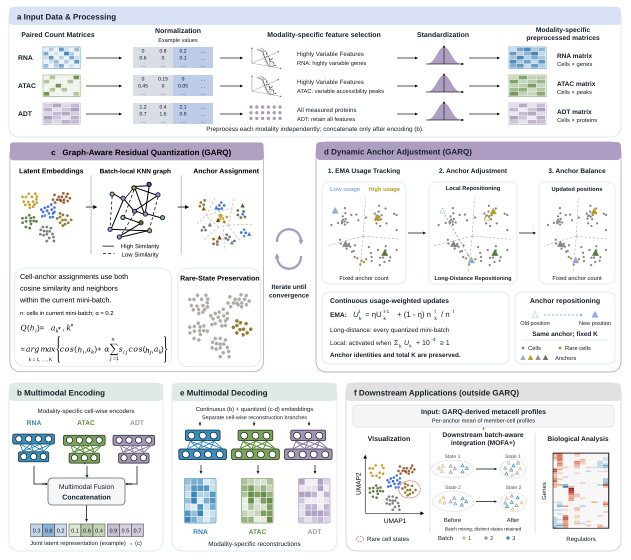

# GARQ

GARQ constructs multi-omics metacells by learning modality-specific representations
and grouping paired cells with graph-aware residual quantization. This repository
contains the original implementation and the main revision-analysis workflows.
The original project remains at [BioLab-Hebut/GARQ](https://github.com/BioLab-Hebut/GARQ).

## Framework



The [PDF framework](frame.pdf) and [implementation notes](METHODS.md) describe
modality-specific preprocessing, cell-wise encoding, batch-local graph-aware
quantization and usage-dependent adjustment of a fixed set of anchors.

## Run GARQ

Use the [tutorial](GARQ_Tutorial.ipynb) or the input-checking launcher:

```bash
python tools/run_garq.py --data_file datasets/rna.h5ad datasets/adt.h5ad --data_type RNA ADT --save_name example --n_GARQs 500 --seed 1 --device cuda
```

Inputs are modality-specific count matrices for the same paired cells in the
same row order. Cell-type annotations are optional for construction.
[TOOLS.md](TOOLS.md) describes input validation and restoring cell/feature names
to separate output copies without changing numerical values.

The root model files retain the original implementation. Revision workflows use
their documented source versions; source identity checks prevent accidental
substitution between versions.

## Revision analyses

The [workflow index](experiments/REVISION_WORKFLOWS.md) maps the main analyses to
reviewer topics and their run instructions. It covers modality comparisons,
controlled representations and aggregation, abundance-reduction controls,
trajectory and downstream analyses, computational profiling and batch sensitivity.

For example, with the original inputs configured:

```bash
export GARQ_INPUT_ROOT=/path/to/revision-inputs
export GARQ_REVISION_OUTPUT=/path/to/new-output
python experiments/comparative_analysis/code/module_B_v2.py
```

## Environments and data

`environment.yaml` records the historical Linux/CUDA environment;
`requirement.ymal` is retained as its compatibility alias. Individual workflows
use separate GARQ, SEACells and R environments. See
[dependencies](experiments/DEPENDENCIES.md) and
[recorded environment versions](experiments/ENVIRONMENT_VERSIONS.md).

The package includes source and settings. Raw matrices, checkpoints, saved
memberships and trajectory objects are external inputs described by each
workflow. Public example datasets are available from
[Figshare](https://doi.org/10.6084/m9.figshare.32751672).
Use new output directories and preserve the specified input identity checks.
